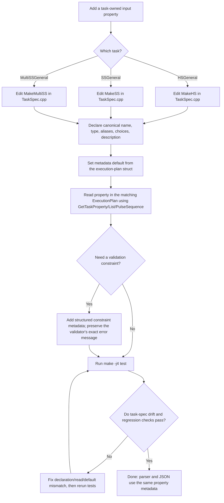

# Adding a task property

Use this flow for task-owned properties of `HSGeneral`, `SSGeneral`, or
`MultiSSGeneral`. Interaction, State, and Transition properties are outside
this task spec.

## Where to make changes

- Add the property's metadata to `MakeHS`, `MakeSS`, or `MakeMultiSS` in
  [TaskSpec.cpp](./TaskSpec.cpp). Include its canonical name, value type,
  aliases, accepted choices, and one-line description.
- Read it in the corresponding execution plan using
  `GetTaskProperty`, `GetTaskPropertyList`, or `GetTaskPulseSequence` from
  [TaskSpec.h](./TaskSpec.h). Use the canonical property name; the helper
  checks the declared aliases too.
- Keep the exported default aligned with the execution-plan struct default.
  Defaults already sourced from a plan struct are set in the matching
  `SetHSDefaults`, `SetSSDefaults`, or `SetMultiSSDefaults` in `TaskSpec.cpp`.
- If adding a constraint, declare its structured condition and preserve the
  exact existing validator error text in its `message`.
- Run `make -j4 test`. The task-spec check verifies declared properties match
  the execution-plan reads, and checks the exported JSON and required metadata.
